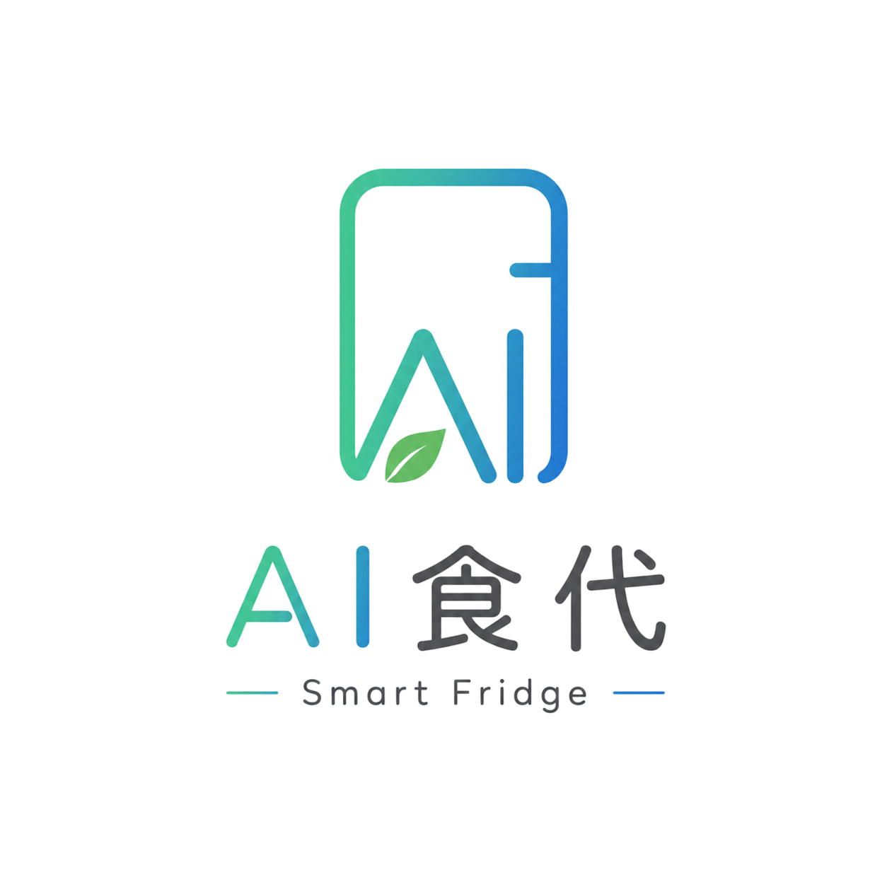
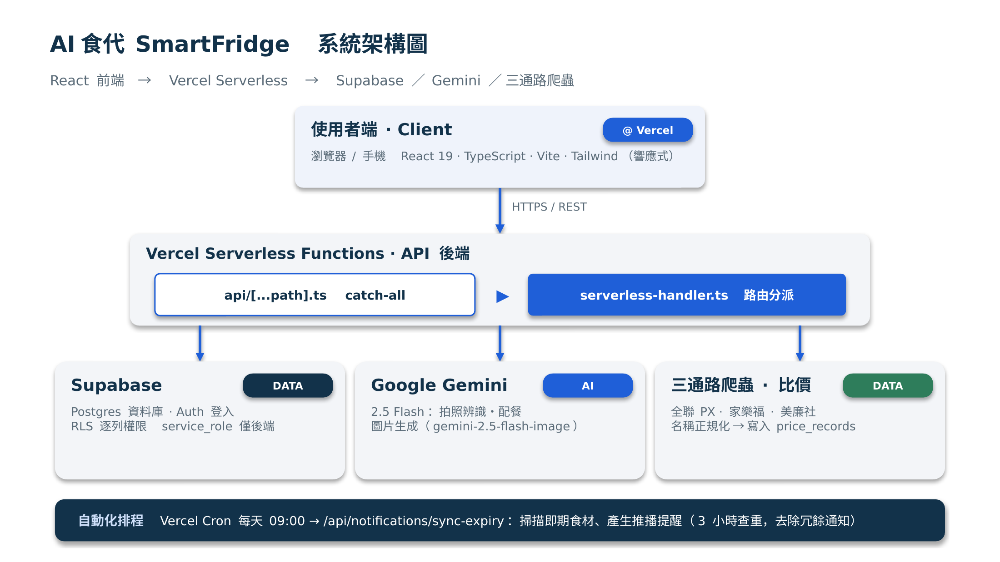

<p align="center">
  
</p>

<h1 align="center">AI食代 SmartFridge</h1>

<p align="center">
  會提醒・會配菜・會比價的智慧食材管家<br>
  「AI 與大數據應用實戰養成班」五人團隊課程專案（2026.06 – 2026.07）
</p>

<p align="center">
  <a href="https://smartfridge-v3.vercel.app/"><b>線上 Demo</b></a> ·
  <a href="docs/LEARNING_NOTES.md">技術複習筆記</a> ·
  <a href="docs/資安詳解.pdf">資安說明</a> ·
  <a href="docs/collaboration/">團隊協作文件</a>
</p>

---

## 解決什麼問題

前測問卷中，5 位受訪者**全部**只靠記憶管理冰箱、沒用過任何 App，常見困擾是：

- 食材放到過期才發現
- 重複買到家裡已經有的東西
- 不知道現有食材能煮什麼
- 不知道同一樣東西哪家賣場比較便宜

AI食代把這些串成一條龍：**拍照入庫 → 到期提醒 → AI 配餐 → 缺貨補貨 → 三通路比價**。

## 主要功能

| 功能 | 說明 | 技術重點 |
|------|------|----------|
| 📸 AI 拍照辨識入庫 | 拍一張冰箱照片，自動辨識食材、分類、份量與可儲天數 | Gemini 2.5 Flash 多模態；AI 沒給天數時改查蔬果儲運溫度參考表 |
| ⏰ 快過期提醒 | 每天早上 9 點掃描即期食材並推播 | Vercel Cron 排程，並檢查避免重複通知 |
| 🍳 AI 智慧配餐 | 依現有食材產生食譜，可排除過敏原、疾病禁忌、指定烹調方式 | Prompt 設計 + 回傳 JSON 驗證 |
| 🛒 智能採購清單 | 缺貨自動加入清單、補貨提醒 | Supabase CRUD |
| 💰 三通路比價 | 全聯／家樂福／美廉社即時查價，保存價格時間序列 | 爬蟲 + 規則式品名正規化 + 每日排程同步 |
| 👨‍🍳 主廚食譜社群 | 分享食譜、按讚、收藏、追蹤、主廚等級 | 多對多關聯資料表 |
| 📱 手機 App 體驗 | 可加到主畫面，全螢幕開啟 | PWA manifest + iOS safe-area |

> **設計原則：對的任務用對的工具。** 只有「看圖辨識」和「寫食譜」用 AI；爬蟲、比大小、品名比對都交給程式和 SQL，省 token 也更穩定。

## 系統架構



| 層級 | 技術 |
|------|------|
| 前端 | React 19、TypeScript、Vite、Tailwind CSS v4、Motion |
| 後端 | Vercel Serverless Functions（單一 catch-all route → `serverless-handler.ts` 分派） |
| 資料庫／登入 | Supabase（Postgres + Auth + Row Level Security，14 張表皆啟用 RLS） |
| AI | Google Gemini 2.5 Flash |
| 排程 | Vercel Cron（即期通知、比價同步） |

專案一開始用 **Flask + MySQL + Docker Compose** 在本機開發，後來為了能真正上線給人用，遷移到 **Vercel + Supabase**。舊版程式保留在 [`legacy/flask-docker/`](legacy/flask-docker/) 作為對照。

## 團隊分工

| 成員 | 負責範圍 |
|------|----------|
| 小靜 | 專案地基：基礎建設、登入認證、Gemini 共用模組 |
| 小賀 | 三通路爬蟲比價、品名正規化、價格趨勢 |
| 小楊 | AI 拍照辨識入庫、快過期提醒；手機 PWA（App 圖示、全螢幕）、比價每日排程、通路地圖 |
| 小金 | 主廚食譜社群 |
| 小莊 | 採購清單、AI 配餐、補貨提醒 |

### 我們怎麼協作

- **一份共同合約**：開工前先寫好 [`ARCHITECTURE.md`](docs/collaboration/ARCHITECTURE.md)，固定資料表欄位、API 格式與命名規則。每個人跟 AI 協作時都先貼這份，避免五個人的 AI 各寫一套。
- **一個功能一個資料夾**：每人只改自己負責的 feature 資料夾，減少衝突。
- **Git branch + Pull Request**：每個功能開自己的 branch，經 review 才合併進 `main`。
- **變更紀錄**：每次全組通過的修改都記在 [`CHANGELOG.md`](docs/collaboration/CHANGELOG.md)。

新成員上手流程寫在 [`START_HERE.md`](docs/collaboration/START_HERE.md)，分工細節在 [`WORKFLOW.md`](docs/collaboration/WORKFLOW.md)。

## 目錄結構

```
├── src/                    前端（React）
│   ├── components/         各頁面：食材庫、配餐、採購、社群、設定…
│   └── lib/                api.ts（API 呼叫）、supabase.ts
├── api/[...path].ts        Vercel 唯一 API 入口
├── serverless-handler.ts   後端主要邏輯：登入、AI、爬蟲、排程
├── supabase/               資料表權限（RLS）與通知 SQL
├── public/ · assets/       App 圖示與 logo
├── docs/
│   ├── LEARNING_NOTES.md   技術複習筆記
│   ├── RUNTIME.md          部署與環境變數說明
│   ├── 資安詳解.pdf        密碼雜湊、Session、RLS 等五大資安機制
│   ├── collaboration/      團隊協作文件（合約、分工、開發紀錄）
│   └── references/         蔬果儲運溫度參考資料
└── legacy/flask-docker/    初版 Flask + MySQL + Docker 架構
```

## 在本機執行

```bash
npm install
cp .env.example .env.local   # 填入 Supabase 與 Gemini 金鑰
npm run dev                  # http://localhost:3000
```

本機開發時，`/api` 會轉送到已部署的 Vercel 後端（見 `vite.config.ts`）。完整環境變數與部署步驟見 [`docs/RUNTIME.md`](docs/RUNTIME.md)。

## 成果與反思

**做到的**
- 核心功能全部完成並部署上線，手機與桌機都能用
- 以 5 人實拍、38 種食材比較三家 AI 的辨識結果後選用 Gemini

**還可以更好的**
- 比價的品名比對仍需使用者手動確認
- Gemini 圖片生成 API 改為付費後，AI 食譜配圖暫停
- 配餐完成後還沒有自動扣除庫存
